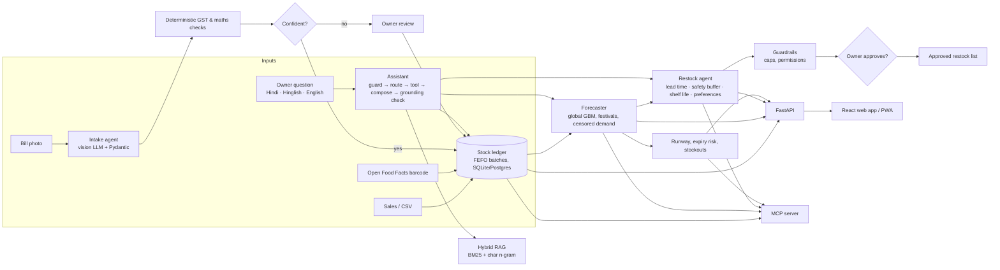

# Stockora

**See what will run out and what will expire, before it happens.** Stockora forecasts demand for every product in an Indian kirana store (festivals included), shows how many days each item will last, flags batches that won't sell before their expiry date, and suggests how much to restock so neither happens. Bills are read from a photo, and the owner can ask questions in Hindi, English or Hinglish.

India has over a crore of small retail stores, and most still run on the owner's memory: fast sellers run out on the busiest day, while milk, bread and paneer expire on the shelf. Billing apps record what was sold. Stockora predicts what happens next, explains why, and leaves every decision to the owner.

> **Status (11 Nov 2026): not yet validated on Indian shop data.** Every measured result below comes from non-Indian public datasets (Favorita, Ecuador; Walmart M5, USA,and rohilik) or from clearly labelled synthetic data. The demo store's sales history is synthetic. No real shop has used Stockora yet. A pilot kit is ready ([PILOT.md](PILOT.md)) for when shop data can be collected.

---

## What it does

| Feature | How it works |
|---|---|
| **Precise inventory** | For every product: daily sales rate, 7-day forecast with an 80% range, the exact date it runs out (walking the daily forecast, not an average), a reorder point, last-7/28-day sales and trend |
| **Product view** | 8 weeks of daily sales with out-of-stock days marked, the 14-day forecast band, projected stock until it hits zero against the reorder point, and every batch with its expiry and units at risk |
| **Shop demand** | Whole-shop sales for the last 4 weeks and the next 2 weeks' forecast with its range, festival days marked |
| **Demand forecasting** | Picked by a model competition on three real datasets (see Results): a global XGBoost model (Tweedie loss) blended with per-product exponential smoothing; Indian festival calendar (Diwali, Eid, Holi, Navratri, Ganesh Chaturthi…), salary-week and seasonal features (so far exercised only on synthetic Indian demand, not real Indian sales); **censored-demand correction** for days an item was out of stock |
| **Understock alerts** | Items that run out within 3 days or this week, items that ran out recently and how much demand went unserved (units), and items customers asked for that weren't on the shelf ("kisi ne maanga") |
| **Expiry alerts** | FEFO-aware: for every batch, how many units will sell before the date and how many won't, with an action (move to the counter, combo, discount, return) |
| **Restock suggestions** | Quantities cover forecast demand until the next delivery plus a safety buffer per category, capped by shelf life so perishables are never over-ordered; the owner edits and approves, and Stockora learns from every edit |
| **Bill photo → stock** | Vision LLM extracts quantities, batches and expiry dates into a Pydantic schema; deterministic code checks GSTIN checksum, GST split and totals; low-confidence lines go to the owner; corrections become aliases |
| **Ask Stockora** | An LLM agent (Groq) with 10 shop tools: it calls as many as a question needs, remembers the conversation for follow-ups, and replies in clean English or Hindi (Devanagari) as the owner chooses; questions can be typed or spoken in English, Hindi or Hinglish. **Any answer containing a number that is not in the tool results is discarded** and a checked answer is shown instead. Works offline with rule-based answers when no key is set |
| **Udhaar** | Customer credit with risk flags (old, growing dues) and WhatsApp reminders |
| **Counter billing** | Search or scan (phone camera or USB scanner) items, packs or loose by weight (kg/g/L/ml), discounts, cash/UPI/udhaar/split payment. GST tax invoice (CGST+SGST, or IGST for a registered buyer from another state), bill of supply for composition shops, plain bill for unregistered shops. Numbered per financial year (e.g. SGS/26-27/0001). PDF in A4, 80 mm and 58 mm thermal layouts; share on WhatsApp. Saving a bill takes the goods out of stock batch by batch (earliest expiry first), so run-out dates and expiry alerts change at once; udhaar goes to the customer's account. History and search, cancel (same month) or return items with a credit note, and a daily summary in units |
| **Area trends, privately** | "Beverages are selling more in your area this week": each shop shares only a noisy category-level change; an area is shown only when 5+ shops take part. No raw sales, units or customers ever leave the shop |
| **MCP server** | The same tools over the Model Context Protocol, usable from Claude Desktop, Cursor, VS Code or any MCP client |
| **English or Hindi** | One tap switches the whole app (every page, bills screen, charts, messages) between English and Hindi (Devanagari) |
| **First-run setup** | A wizard for a new shop: shop details and GST scheme, then either import the item list and past sales from a billing app export (columns detected automatically, shown in a preview the owner can fix) or tick common items and type the shelf count. Several shops can live side by side, including the labelled demo shop |
| **Fast start** | Forecasts are saved to disk with a version number, so the app opens in seconds; retraining runs in the background once a day and the previous version is kept as a fallback |
| **Human-in-the-loop by design** | Agents draft; only the owner approves |

## Results

## Which forecaster: a model competition on three real datasets

25 candidates (classical per-product methods; boosted trees from scikit-learn, LightGBM and XGBoost with Poisson and Tweedie losses; ensembles) were tested on three very different public datasets: Favorita (54 Ecuadorian supermarkets, store x product family), Walmart M5 (single items, 3 US stores) and Rohlik (online grocer in Czechia and Hungary, 2,554 fresh-food items in 3 warehouses). The winner had to be one configuration for all three. It was picked on validation windows and confirmed on later test windows that were never used for choosing. LightGBM and XGBoost settings were fixed before the first run. Full report, including every place the winner loses: [`backend/evals/COMPETITION_REPORT.md`](backend/evals/COMPETITION_REPORT.md).

**Winner: 75% XGBoost (Tweedie loss) + 25% per-product exponential smoothing.** It is the default forecaster in the app (falling back to the previous winner if xgboost is not installed).

| Held-out test windows, weekly accuracy | Favorita (store x family) | M5 (single items) | Rohlik (item x warehouse) |
|---|---|---|---|
| **Stockora (winner)** | **91.5%** | **61.0%** | **84.5%** |
| Previous winner (3 scikit-learn boosted models + smoothing) | 91.4% | 61.1% | 84.0% |
| XGBoost alone | 91.4% | 60.7% | 83.8% |
| LightGBM alone | 91.0% | 60.7% | 83.7% |
| Best classical method (TSB) | 90.3% | 59.9% | 81.4% |
| 28-day moving average | 88.9% | 59.5% | 80.2% |

Accuracy = 1 − WAPE. The gain over the previous winner is small (about 1% less relative error on average) and not uniform: on M5 the new winner is 0.1 points worse. Blending a global model with per-product smoothing helps on every dataset; no single model alone wins. Rohlik days on which an item sold out (availability below 1) count as censored demand and are not scored. Single items sell 0-2 units on most days, so item-level accuracy is naturally lower. None of the datasets is Indian, so these numbers are not evidence of accuracy in Indian kirana stores. Stockora has not been validated on Indian sales data. That needs a real-shop pilot, which is on hold until shop data can be collected ([PILOT.md](PILOT.md) is the ready kit).

### Restocking simulated on real demand (Favorita, Ecuador; measured with the previous model)

| Ordering on real demand, 8 weeks, 162 series | Gut-feel rule (simulated) | Stockora |
|---|---|---|
| Days an item was out of stock | 4.3% | **1.8% (−57%)** |
| Demand served | 98.4% | **99.6%** |
| Stock held (days of sales) | 3.43 | **3.01 (−12%)** |

This is a simulation: both ordering rules are replayed against the same real Favorita demand. "Gut feel" is a simulated ordering rule, not real shop owners, and no real shop has ordered with Stockora.

Privacy-preserving area trends (tested on Favorita, with Ecuadorian cities as areas and stores as shops; k = 5 shops, ε = 2): direction correct 75% of the time on clear moves; published only where at least 5 shops report.

### Simulated kirana (synthetic demand; real Indian product names and festival dates)

From `python -m evals.run_evals` ([`backend/evals/REPORT.md`](backend/evals/REPORT.md)). Everything in this section is measured on synthetic or hand-written test data, not on real shops. It checks that each part works; it is not evidence of real-shop performance.

| 10 festival weeks (Ganesh Chaturthi to Diwali eve) | Gut feel | Stockora | Stockora lean |
|---|---|---|---|
| Days an item was out of stock | 9.0% | **3.0% (−67%)** | 7.9% |
| Expired stock vs gut feel | – | −12% | **−49%** |
| Stock held vs gut feel | – | +25% | **−11%** |

| Component | Result |
|---|---|
| Product matching, 450 messy names (typos, Hinglish, abbreviations) | 100% top-1; 98.9% auto-accepted at 100% precision |
| Bill validation, 240 GST bills with injected errors | 100% caught, 0% false alarms |
| Assistant intent routing (offline, no LLM), older and mostly Hinglish question set | 100% dev, 89.3% held-out; superseded by the chatbot evaluation below |
| Prompt-injection attempts blocked | 100% (0% false refusals) |
| Hallucinated numbers caught by the grounding check | 86% |

### Chatbot evaluation: pure English and pure Hindi (11 Nov 2026)

96 new questions, 48 in English and 48 in Hindi (Devanagari), no Hinglish, asked of the synthetic demo store: 80 shop questions, 8 out-of-scope, 8 prompt-injection attempts. Half are *dev* questions that may be used to improve the router and half are *held-out* questions that may not. Full report: [`backend/evals/ASSISTANT_EVAL.md`](backend/evals/ASSISTANT_EVAL.md).

| Offline mode (rules, no LLM) | English | Hindi |
|---|---|---|
| Right tool picked, held-out questions | 50% (10/20) | 55% (11/20) |
| Right tool picked, dev questions (used for tuning, so not evidence) | 100% (20/20) | 100% (20/20) |
| Answers where every number is found in the tool results | 100% (40/40) | 100% (40/40) |
| Answer language is pure | 100% (40/40) | 87.5% (35/40) |
| Prompt-injection attempts refused | 4/4 | 4/4 |

Mean time per question: 9.5 ms. Without an LLM, the rule-based router picks the right tool for only about half of phrasings it has not seen before.

**Groq agent mode, first run (11 Nov 2026, `openai/gpt-oss-120b`, owner's PC, same 96 questions):**

| Agent mode, first run | English | Hindi |
|---|---|---|
| Right tool picked, held-out questions | 80% (16/20) | 85% (17/20) |
| Right tool picked, dev questions | 95% (19/20) | 90% (18/20) |
| Right product on product questions | 8/8 | 8/8 |
| Answers where every number is found in the tool results | 100% (40/40) | 100% (40/40) |
| Answer language is pure | 100% (40/40) | 75% (30/40) |
| Prompt-injection attempts refused / out-of-scope questions declined | 4/4, 4/4 | 4/4, 4/4 |

Follow-up questions that used the earlier turn: 5/6. Time per question: median 2.6 s, 95th percentile 12.1 s. 11 of 96 questions hit Groq's free-tier rate limit and were answered by the rules instead. Fixes made after this run, **not yet re-measured**: the agent refused distributor questions (schemes, delivery days, returns) as off-topic, Hindi answers copied English dates and words from tool results, and rate limits were retried too quickly. Full reports: [`ASSISTANT_EVAL_agent_run1.md`](backend/evals/ASSISTANT_EVAL_agent_run1.md).

## Architecture



The daily workflow is a graph with an approval interrupt: `refresh forecast → scan expiry → plan orders → guardrails → ⏸ owner approval → draft orders`. It runs on a small built-in runner or as a **LangGraph** `StateGraph` with a checkpointer and `interrupt_before` (`agents/workflows.py`).

## Design decisions (worth discussing in interviews)

- **The LLM never produces numbers.** Forecasts come from a model; tax and stock maths from code. The LLM reads images and language, and its answers are checked against tool evidence (`genai/guardrails.numbers_grounded`).
- **Rules first, LLM second.** Most shop questions match a handful of patterns, so routing is free, instant and testable; the LLM handles the rest. Works fully offline without an API key.
- **Stock is a ledger.** Current stock = sum of movements; nothing is overwritten. Every query is scoped by `store_id` (tested tenant isolation).
- **Censored demand.** Sales on stockout days understate demand. Training imputes those days (two-pass, EM-style). On the synthetic backtest the model's bias is −4.2%, against −10.7% for a 28-day moving average (`evals/REPORT.md`).
- **Honest evaluation.** On synthetic demand, the forecaster is scored against a *noise floor* (true expected demand, known only because the data is generated), because daily SKU sales are mostly noise; weekly totals are the business-relevant metric. Assistant routing has a held-out set that was not used for tuning.
- **Trade-offs are surfaced, not hidden.** The policy simulation shows the high-service setting holds more stock; a lean setting is reported beside it so the owner can choose.
- **One model for every dataset.** The forecaster was chosen by a competition scored on two very different real datasets (store x family and single items), with validation windows for choosing and later test windows for reporting, so it is not tuned to one dataset. Neither dataset is Indian.

## Try it online

**Live demo: https://stockora-6ol.pages.dev** (sample data, not a real shop)

The public demo runs on free hosting: the website on Cloudflare Pages and the server on Render. The free server sleeps after 15 idle minutes, so the first visit can take about a minute; the site shows a "Starting the demo server" screen meanwhile. The demo resets when the server restarts. How it is set up, step by step: [DEPLOY.md](DEPLOY.md).

## Run it on Windows

Needs Python 3.11, 3.12 or 3.13 (from python.org, with "Add python.exe to PATH" ticked) and Node.js 20+ (LTS).

```powershell
cd D:\stockora
powershell -ExecutionPolicy Bypass -File setup.ps1     # once: venv, packages, tests (safe to re-run)
powershell -ExecutionPolicy Bypass -File start.ps1     # API on :8000, website on :3000 (add -Dev for auto-reload)
```

If setup stops, it prints the reason and a fix, and writes everything to `setup.log`. Common causes: the Microsoft Store "python" shortcut instead of a real install, an unsupported Python version, or OneDrive locking files mid-install (pause syncing while setup runs). Re-running `setup.ps1` repairs a half-built `.venv`.

On first start the backend creates `stockora.db` with a demo store (Sharma General Store, Nashik). Open http://localhost:3000. API docs: http://localhost:8000/docs.

**AI key (free):** create a key at https://console.groq.com/keys, then put it in `backend/.env` (copy `backend/.env.example` to `.env` if it does not exist):

```
GROQ_API_KEY=gsk_your_key_here
```

The default models are `openai/gpt-oss-120b` (chat), `openai/gpt-oss-20b` (fast) and `qwen/qwen3.8-27b` (bill photos); Groq retired the earlier Llama defaults in July and August 2026. Model IDs change, so if the chat reports a model error, set `GROQ_MODEL`, `GROQ_FAST_MODEL` or `GROQ_VISION_MODEL` in `.env` to a current ID from https://console.groq.com/docs/models.

Restart with `start.ps1`. The sidebar shows "AI connected" and the chat answers free-form questions and follow-ups; bill photos can be read. Keep the key out of git and out of chats (`.env` is git-ignored).

**Inside the app:** Ctrl K searches products and pages from anywhere, the bell lists items that run out within 3 days or expire within 2, the moon icon switches to dark mode, and Inventory and Restock export CSV.

**Tests and evaluations**
```powershell
cd backend
.\.venv\Scripts\python -m pytest              # full test suite
.\.venv\Scripts\python -m evals.run_evals     # writes evals/REPORT.md
.\.venv\Scripts\python -m evals.assistant_eval                # chatbot, offline mode; writes evals/ASSISTANT_EVAL.md
.\.venv\Scripts\python -m evals.assistant_eval --mode both    # also the Groq agent (needs the key in .env)
.\.venv\Scripts\python -m evals.favorita_benchmark ..\data\favorita   # real data (download from Kaggle)
.\.venv\Scripts\python -m evals.m5_benchmark ..\data\m5               # real item-level data (Walmart M5)
.\.venv\Scripts\python -m evals.model_competition ..\data\favorita ..\data\m5 D:\rohlik-sales-forecasting-challenge-v2   # which forecaster is best (2-3 h, resumable)
.\.venv\Scripts\python -m evals.competition_report   # writes evals/COMPETITION_REPORT.md
```

**Browser tests (Playwright):** with the app running (`start.ps1`), in `frontend`: `npx playwright test`. They use your installed Google Chrome; screenshots go to `frontend/e2e/screenshots`.

**Docker:** `docker compose up --build` → http://localhost:8080

## Use it with a real shop

No real shop has used Stockora yet, so this path has not been proven with real shop data.

The easiest way: open the app, choose **Set up my shop** (or the shop menu in the sidebar → *Set up a new shop*) and follow the wizard. The command line below does the same from a folder of sheets. Stockora is designed to work from day one for a new shop: until it has 120 days of sales it runs in **learning mode**, blending the shop's recent sales with typical demand for similar items, and keeping orders for never-sold items small. After that the trained model takes over automatically.

```powershell
cd backend
.\.venv\Scripts\python -m stockora.onboard templates --folder ..\shop_data      # blank sheets to fill
.\.venv\Scripts\python -m stockora.onboard create --db shop.db --name "Patil Kirana" --city Nashik --state 27 --cash 25000 --folder ..\shop_data
```

The importer reads item lists and date-wise sales exported from billing apps (Vyapar, myBillBook, Marg, Tally) or a hand-made sheet, matches column names flexibly, fills missing category/HSN/GST/shelf life from the catalog, and lists everything it filled or skipped. Past sales teach the forecaster without changing today's stock. Then set `STOCKORA_DB=shop.db` in `backend/.env`.

In the app, the owner records sales and corrects stock after a shelf count from the Stock page. At the end of a pilot, `python -m stockora.pilot` compares a shadow week (usual ordering) with the assisted weeks.

**Pilot kit (how to find a shop, consent form, 4-week schedule, how to report results): [PILOT.md](PILOT.md).** The pilot itself is on hold until shop data can be collected.

## Use it from Claude Desktop, Cursor or VS Code (MCP)

Add to your MCP client config (adjust the path):

```json
{
  "mcpServers": {
    "stockora": {
      "command": "C:\\Users\\<you>\\Desktop\\stockora\\backend\\.venv\\Scripts\\python.exe",
      "args": ["-m", "stockora.mcp_server"],
      "cwd": "C:\\Users\\<you>\\Desktop\\stockora\\backend"
    }
  }
}
```

Then ask: *"What will run out at my store before Diwali, and what is about to expire?"* Tools: `low_stock`, `product_status`, `order_plan`, `draft_orders`, `expiry_risk`, `lost_sales`, `udhaar`, `morning_briefing`.

## Project layout

```
backend/
  stockora/
    india.py              GSTIN checksum, GST split, slabs, MRP rule, festival & season effects
    db.py                 ledger schema, FEFO, udhaar, orders, preferences, traces
    matching.py           messy-name → product resolver (char n-gram TF-IDF + pack size)
    service.py            single service layer used by API, MCP and assistant
    seed.py               demo store: real catalog, synthetic labelled history
    onboarding.py, onboard.py   import a real shop from billing-app exports (CLI)
    pilot.py              before/after pilot report from the shop's own ledger
    billing.py            counter bills: GST maths, numbering, FEFO stock deduction, udhaar, cancel, credit notes, daily summary
    invoice_pdf.py        bill and credit-note PDFs (A4, 80 mm, 58 mm) with the bundled DejaVu font (reference/fonts)
    forecasting/          global GBM forecaster, classical models (SES, TSB), calendars (India / Ecuador / US), cold start, simulator, policy simulation
    datasets/favorita.py  loader for the real Favorita dataset (store x family)
    datasets/m5.py        loader for the real Walmart M5 dataset (items, prices, US events, SNAP)
    area_trends.py        privacy-preserving area trends (local differential privacy + k-anonymity)
    agents/stock_alerts.py  missed customer requests, shelf-count mismatches, udhaar risk
    agents/               restock (lead time, safety buffer, shelf life), inventory health (expiry, stockouts), workflows (LangGraph)
    genai/                Groq client + tracing, bill intake, hybrid RAG, assistant, guardrails
    connectors/           Open Food Facts barcodes
    api/main.py           FastAPI
    mcp_server.py         MCP server
    reference/            catalog.csv (90 real products), festivals.csv (2025-2027)
  tests/                  unit + integration tests
  evals/                  datasets, run_evals.py, REPORT.md
frontend/                 React + TypeScript + Tailwind (Vite)
```

## Data: what is real and what is not

| Real | Synthetic (labelled) |
|---|---|
| 90 Indian products, brands, pack sizes, HSN codes | Daily sales history of the demo store |
| GST slabs after the 22 Sep 2025 reform (0/5/18/40%), verify rates on cbic-gst.gov.in | Distributor names and delivery days |
| GSTIN checksum algorithm and state codes | Udhaar customers |
| Festival dates 2025-2027 (verify regional dates) | Bills used in the validation eval |
| Barcode data (Open Food Facts) | Size of festival, salary-week and season effects in the demo store's sales |
| GST rules applied on bills (CGST Act s.31, Rule 46) | The demo shop's GSTIN, address and the three loose items' sales (prices approximate) |
| Favorita sales used for real-data testing (Ecuador, store x family level) | |
| Walmart M5 sales and shelf prices used for real-data testing (USA, item level) | |

MRPs are approximate and are overwritten by real bills. No Indian sales data has been used anywhere in this project yet. A real-store pilot would make sales history, bills and owner edits real; it is on hold until shop data can be collected.

## Limitations and roadmap

- **Not validated on Indian data.** The real-shop pilot is on hold until shop data can be collected; the kit is ready (PILOT.md). Until a pilot runs there are no Indian results to report: no real extraction accuracy, stockout or owner-edit numbers.
- The Groq agent mode has had one real run (see the chatbot evaluation); the fixes made after it are not yet re-measured. Bill reading from a real photo is not yet tested.
- Offline (no-LLM) chat picks the right tool for only about half of unseen phrasings (see the chatbot evaluation).
- Check the Indian festival calendar against Google Trends India (timing and state-wise relevance of search interest). This checks the calendar, not sales, so it will not count as Indian validation of the forecasts.
- Measure bill extraction on real photographed bills (the validation logic is evaluated; the vision model's accuracy needs real bills).
- Pretrained forecasting models (Chronos / TimesFM) are not in the model competition yet; LightGBM and XGBoost are. The claim is "best of 25 tested candidates on three real datasets", not state of the art.
- PWA install and offline mode, WhatsApp Business API delivery of restock lists, multi-store transfers.
- The Hindi wording is written by hand and has not yet been reviewed by shop owners.
- Postgres + Alembic migrations for multi-tenant hosting.
